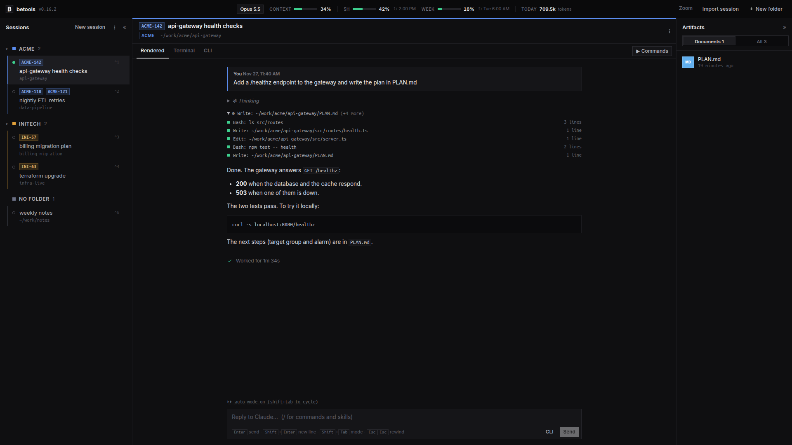
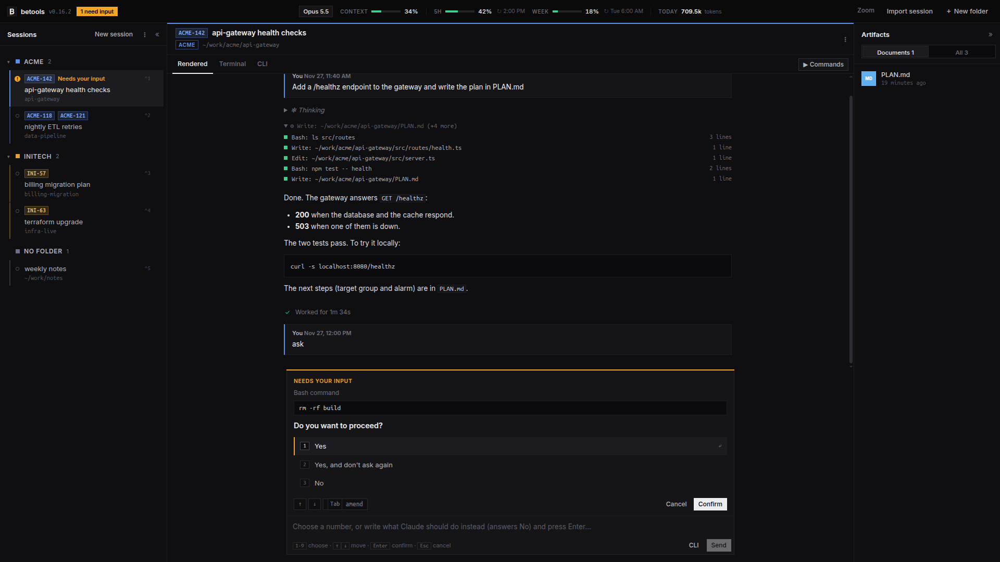
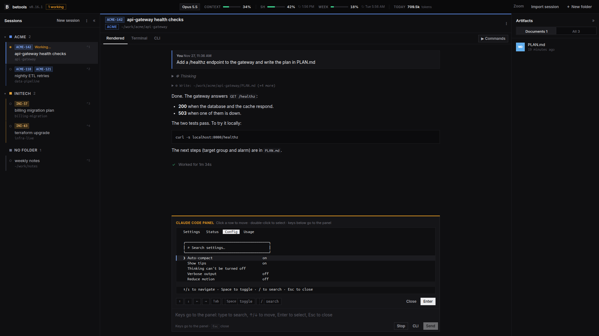
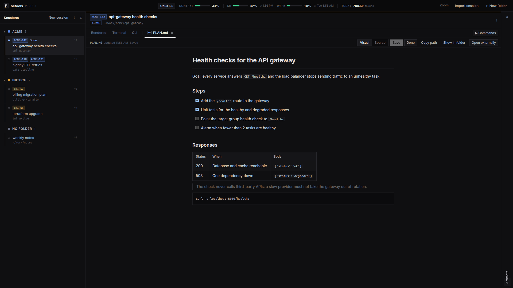
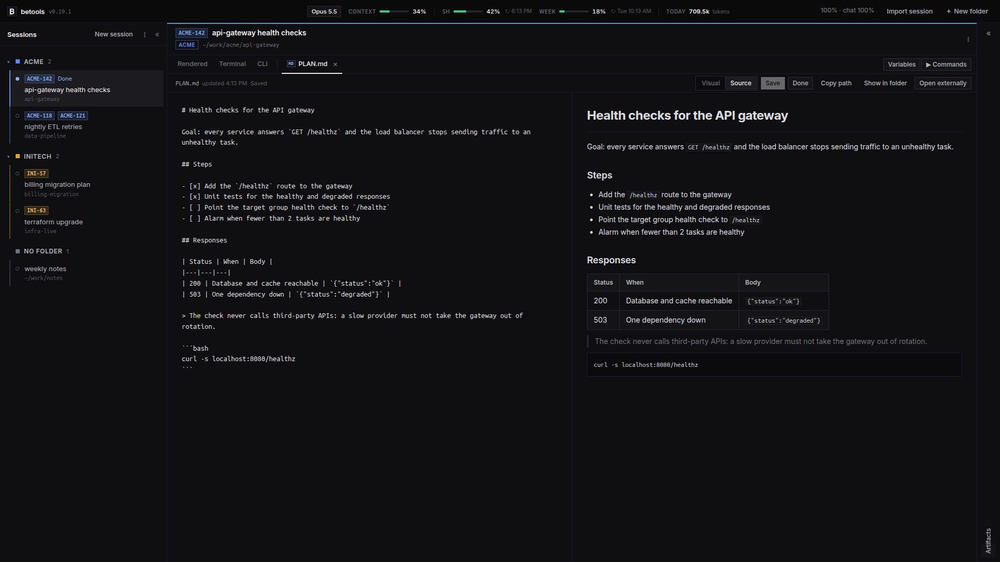
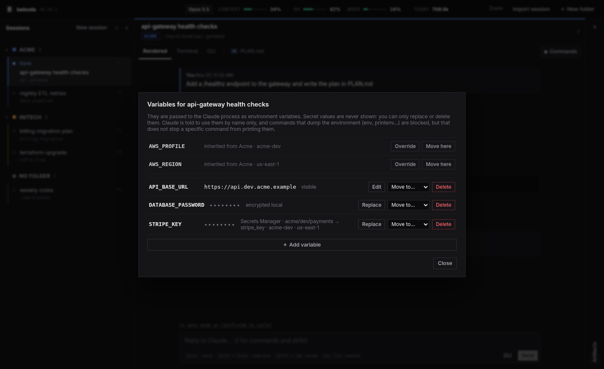

# betools

App de escritorio para Linux que reúne en una sola ventana varias sesiones de [Claude Code](https://code.claude.com/docs) en paralelo, agrupadas por cliente o proyecto.

Cada sesión corre el `claude` CLI real. Se conservan los slash commands, las skills, los permisos, los MCP y los plugins, y betools agrega encima:

- una vista legible de la conversación;
- los archivos que Claude escribió;
- un editor de Markdown;
- variables de entorno por carpeta y por sesión.

> Las capturas usan datos ficticios: los clientes (Acme, Initech), las sesiones, las variables y la conversación son inventados.



## Qué hace

### Sesiones agrupadas por carpeta y con sus tickets

- La barra lateral agrupa las sesiones por carpeta (un cliente o un proyecto, con su color) y muestra el estado de cada una: trabajando, necesita tu respuesta o terminó.
- Cada sesión muestra su ticket de Jira como etiqueta, teñida con el color de la carpeta. El título sigue el formato `<TICKET> [<TICKET>…] <resumen>`; por ejemplo, `ACME-118 ACME-121 nightly ETL retries` muestra dos etiquetas y el resumen debajo. El primer ticket es el principal y aparece también en el encabezado de la sesión.
- El título se edita con doble clic en la sesión, o se lee de `~/.claude/tab-titles/<id de sesión>` si un hook lo escribe ahí. Sin título, se usa el de `/rename` o el que genera Claude.
- Las sesiones se restauran al reiniciar la app o la PC (`claude --resume`).
- Se puede importar una sesión que se abrió fuera de betools.
- `Ctrl+1…9` y `Ctrl+Tab` cambian de sesión.

### Rendered, Terminal y CLI

Cada sesión tiene tres pestañas:

- **Rendered**: la conversación con formato. Incluye el texto, el razonamiento, las herramientas con su resultado y los bloques de código. Desde ahí se escribe, se adjunta y se responde.
- **Terminal**: una shell en la carpeta de la sesión, con las variables de la sesión. Cada carpeta puede tener comandos guardados (p. ej. `aws sso login`).
- **CLI**: la TUI de Claude Code tal cual, para lo que haga falta.

La barra superior muestra el modelo, el uso del contexto, los límites de 5 horas y semanal del plan y los tokens del día.

### Permisos y preguntas sin ir a la terminal

Los pedidos de permiso, las preguntas de Claude (AskUserQuestion) y los formularios de los MCP aparecen en Rendered con sus opciones. Se responden con un clic, con el número o escribiendo qué hacer en lugar de eso.



### Paneles de Claude Code

`/config`, `/usage`, `/model`, `/mcp`, `/permissions`, `/resume` y el resto de los paneles de la CLI se dibujan en Rendered. Se navegan con clic o con el teclado, y cada atajo tiene su botón.



### Artefactos y editor de Markdown

- El panel de la derecha lista los archivos que Claude creó o editó en la sesión.
- Los `.md` se abren en una pestaña propia y se editan de dos formas:
  - **Visual**: sobre el documento renderizado, como en Notion. Al guardar, lo que no se tocó queda igual byte a byte y solo se reescribe el párrafo o el ítem editado.
  - **Source**: la fuente a la izquierda y la vista previa en vivo a la derecha.
- Si Claude cambia el archivo mientras lo editas, betools no lo pisa: avisa y te deja elegir qué versión conservar.





### Variables de entorno

Cada carpeta y cada sesión pueden tener variables que llegan al proceso de Claude. Las de la sesión pisan a las de la carpeta. Hay tres tipos:

- **Visible**: no es secreta (p. ej. `AWS_PROFILE`). Se guarda en texto plano y se muestra.
- **Encrypted local**: se cifra con el llavero del sistema y nunca se muestra; solo se puede reemplazar o borrar.
- **Secrets Manager o SSM**: se guarda solo la referencia y el valor se lee al arrancar la sesión. Sirve para las credenciales de clientes, que no deben quedar guardadas en la máquina.



## Instalación

Requisitos:

- Linux con `apt` (se empaqueta como `.deb`);
- Node.js;
- el CLI de [Claude Code](https://code.claude.com/docs) instalado y con sesión iniciada.

```bash
npm install
npm run dist
sudo apt install "$PWD/dist/betools_<versión>_amd64.deb"
```

Antes de instalar una versión nueva, cierra betools desde el ícono de la bandeja (Quit).

## Desarrollo

```bash
npm run dev          # la app con recarga en caliente
npm run typecheck
npm test             # Vitest
npm run test:e2e     # Playwright sobre la app compilada, con un "claude" falso
```

Las pruebas e2e usan un HOME, una carpeta de datos y un `claude` falsos (`test/e2e/fake-claude.mjs`): no tocan `~/.claude` ni llaman a ningún modelo.

Para regenerar las capturas de este README con los mismos datos ficticios:

```bash
npm run build && README_SHOTS=1 npx playwright test -c test/e2e/playwright.config.ts readme-shots
```

El diseño, las decisiones y el historial de versiones están en [PLAN.md](PLAN.md).
